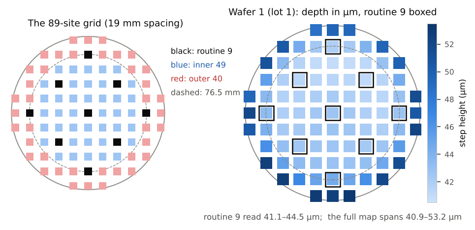

# Sparse wafer-map metrology

**Predicting a wafer's full etch-depth map from a few measured sites, with an error bar at every site.**

Semester project for MTLE-6730 (Materials Informatics), Rensselaer Polytechnic Institute, Fall 2026 · Ariful Islam · *Work in progress: part 1 of 4 done*

[](https://colab.research.google.com/github/arifulRPI/sparse-wafer-metrology/blob/main/notebooks/01_core_reconstruction.ipynb)

## The problem

After a deep-silicon etch, a fab checks the etch depth at a few sites on each wafer. Measuring all 89 sites of a full map is slow, so the routine plan here reads 9: the centre, four sites at 54 mm and four at 76 mm. But this tool etches deepest at the outer edge, beyond 76 mm, where the routine plan has no sites. On the first wafer, the routine 9 read 41.1–44.5 µm, while the full 89-site map spans 40.9–53.2 µm.



**The question:** from a handful of measured sites, can we predict the whole map, including the edge, and say how sure we are at each site? Later parts ask how many sites to measure, where to put them, and whether keeping history is worth its cost.

## Approach

1. **Learn shapes from past wafers.** Remove each wafer's mean depth and the average map. What is left is how each wafer differs in shape from a typical one. PCA then finds the few patterns that recur. On this tool, they are an edge ring (64% of the shape variation), a left–right tilt (19%) and two small edge features.
2. **Fit a new wafer from a few readings.** Bayesian linear regression uses the k measured sites to estimate the wafer's mean depth and how much of each shape it has. Priors learned from past wafers keep the answer sensible even with 3 readings for 5 unknowns. The output is a full 89-site map with a 90% prediction interval at every site.
3. **Compare with a simpler use of history.** *Rival A* takes the average past map and shifts it up or down to match the readings.
4. **Test fairly.** Hold out one whole lot at a time and learn everything from the other nine (leave-one-lot-out). Measure each test wafer at k random sites, with 200 layouts per k. Score the RMS error at the sites that were not measured, for the inner 49 sites (within 76.5 mm) and the outer 40 separately.


## Results so far (part 1)

| Error at unmeasured sites (µm, RMS) | Inner 49 | Outer 40 |
|---|---|---|
| Ours, 5 random sites | **0.043** | **0.116** |
| Rival A, 5 random sites | 0.084 | 0.195 |
| Ours, the routine 9 | **0.021** | **0.109** |
| Rival A, the routine 9 | 0.075 | 0.190 |
| Ours, all 89 sites measured (the floor four shapes can reach) | 0.024 | 0.064 |

- With 5 sites, the error is **41–49% lower than rival A**. Ours wins in **all 10 held-out lots**, by 19–64%.
- **The routine 9 never touch the edge, yet from those 9 readings alone the model predicts the 40 outer sites to 0.109 µm** (rival A: 0.190 µm). It reads the edge from the inner sites through the edge-ring shape.
- The rebuilt pipeline reproduces an earlier feasibility run (0.114 vs ~0.10 µm at 3 sites; 0.084 vs ~0.086 µm at 5).


*These scores leave out two bad readings (below). Target: step height.*

## Data checks

- **The two instruments agree once aligned.** The 9-site campaign's coordinates turn out to be rotated 180° relative to the 89-site maps. After undoing the turn and a constant 1.06 µm offset, the two instruments agree to 0.047 µm RMS over 657 readings on 73 wafers.
- **Two bad readings.** A median/MAD screen compares each reading with its neighbours, after removing the wafer's level and the typical map. It flags exactly two readings, 11.5 and 15.9 µm shallower than their neighbours suggest. Left in, they take over PCA's top two shapes. They are fixed in the training data only; test wafers are never changed.


## Known issues, found in part 1

- **A bad reading among the measured sites spreads across the predicted map**, more than it does for rival A. *Planned:* check each reading against what the others predict before trusting the map.
- **Lot 1 is unlike the others.** It tilts left to right up to 2.3× more than any other lot and is the hardest lot. *Planned:* flag wafers whose fitted shapes are far from typical.
- **The 90% intervals are slightly narrow**: they cover 86% of true depths. *Planned:* recalibrate them on the training lots.
- **Edge error levels off** near 0.09 µm with random sites. *Planned:* choose the sites deliberately.

## Roadmap

- [x] **Part 1.** Data checks, bad-reading screen, PCA shapes, Bayesian fit with 90% intervals, rival A, leave-one-lot-out testing.
- [ ] **Part 2.** Rivals that use little or no history (a polynomial and a Gaussian process); the routine 9 as actually read by the second instrument; training only on earlier lots (forward chaining); lot-resampled error bars.
- [ ] **Part 3.** Calibrated intervals; greedy site selection compared with the routine and random layouts; flagging unusual wafers.
- [ ] **Part 4.** Cost: how many fully measured reference wafers are needed, and accuracy against measurement budget.

## Run it

- **Colab:** click the badge above, then Runtime → Run all. The data loads straight from this repository, and the notebook runs in under a minute.
- **Locally:** `pip install -r requirements.txt`, then open `notebooks/01_core_reconstruction.ipynb`. To redraw the README figures, run `python scripts/readme_figures.py`.

```
notebooks/   one notebook per part
data/        the two wafer-measurement files used (see data/README.md)
figures/     figures shown here
scripts/     the script that draws the README figures
```

## Data and credit

Data: J. Langer et al., *A Multi-Model Dataset for BOSCH Plasma-Etching: Optical Emission Spectra, Process Parameters, and Wafer Measurements for Data-Driven Plasma Modeling*, Zenodo (2025), [doi:10.5281/zenodo.17122442](https://doi.org/10.5281/zenodo.17122442), licensed [CC BY 4.0](https://creativecommons.org/licenses/by/4.0/). Only the two wafer-measurement files are included here, unchanged.

**AI use.** The code, figures and this README were written with help from Claude (Anthropic), an AI assistant. I set the question and scope, chose the approach, and checked the results.

Code: MIT License (see `LICENSE`). Data: CC BY 4.0, from the original authors.
