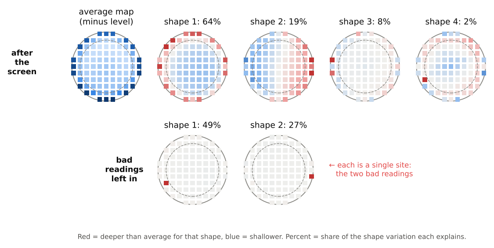
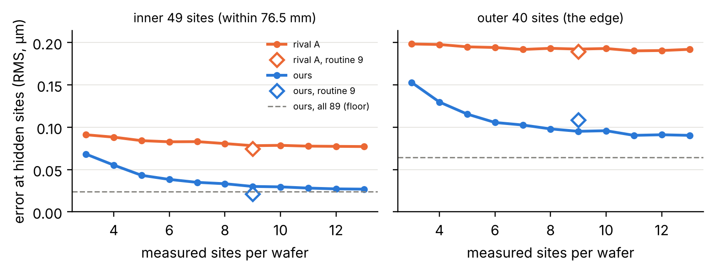
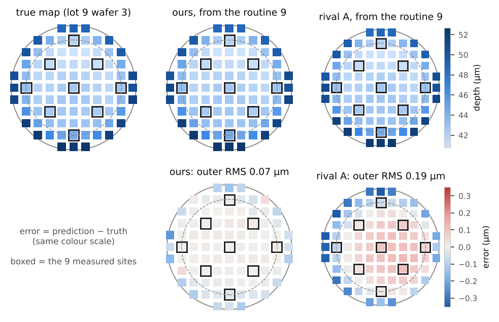
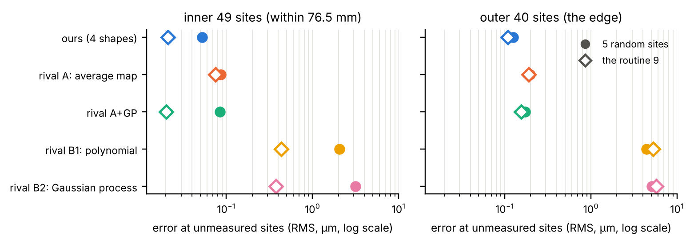
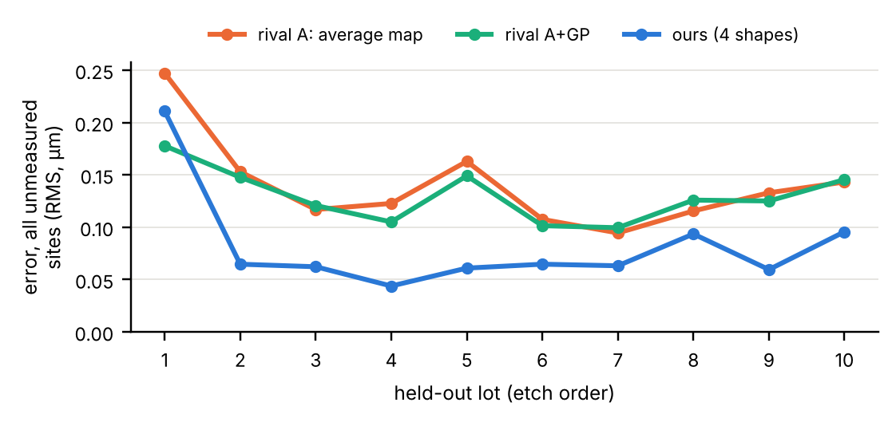
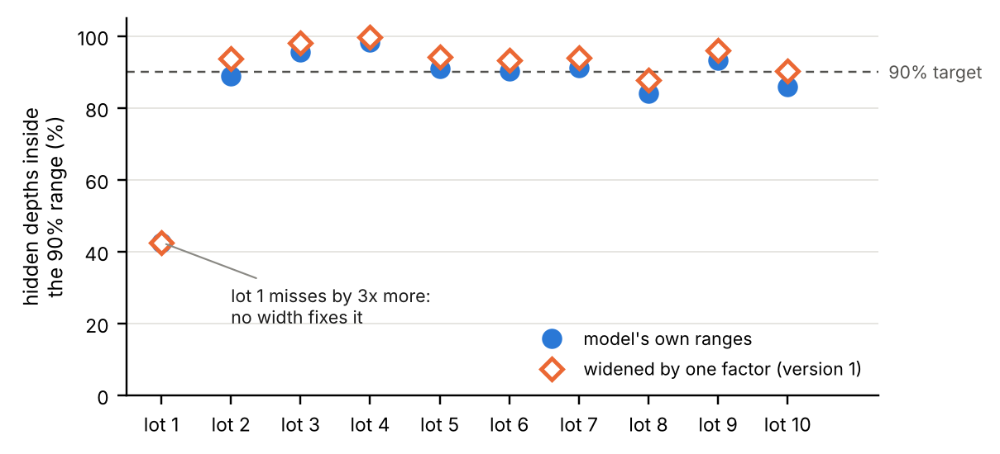
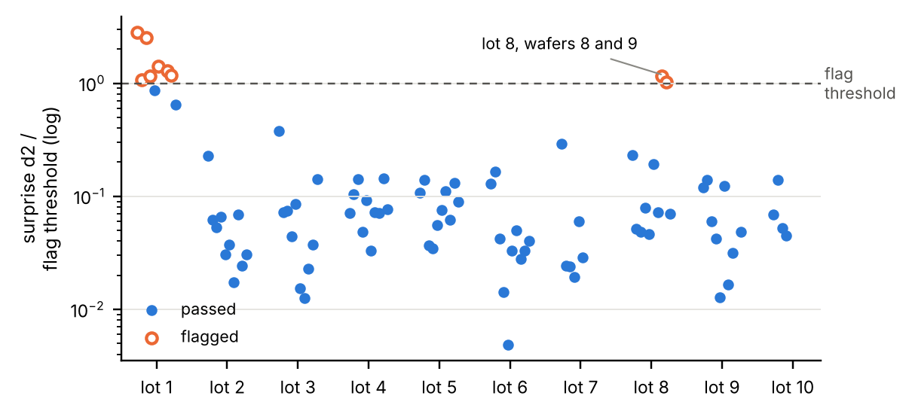
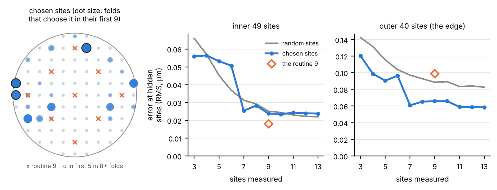
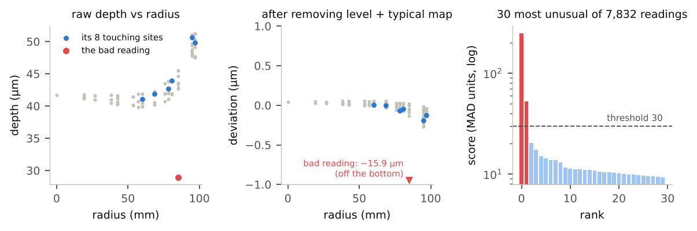

# Sparse wafer-map metrology

**Predicting a wafer's full etch-depth map from a few measured sites, with an error bar at every site.**

Semester project for MTLE-6730 (Materials Informatics), Rensselaer Polytechnic Institute, Fall 2026 · Ariful Islam · *Work in progress: part 3 of 4 done*

Part 1: [](https://colab.research.google.com/github/arifulRPI/sparse-wafer-metrology/blob/main/notebooks/01_core_reconstruction.ipynb) · Part 2: [](https://colab.research.google.com/github/arifulRPI/sparse-wafer-metrology/blob/main/notebooks/02_baselines_and_realism.ipynb) · Part 3: [](https://colab.research.google.com/github/arifulRPI/sparse-wafer-metrology/blob/main/notebooks/03_trust_and_sites.ipynb)

## The problem

After a deep-silicon etch, a fab checks the etch depth at a few sites on each wafer. Measuring all 89 sites of a full map is slow, so the routine plan here reads 9: the centre, four sites at 54 mm and four at 76 mm. But this tool etches deepest at the outer edge, beyond 76 mm, where the routine plan has no sites. On the first wafer, the routine 9 read 41.1–44.5 µm, while the full 89-site map spans 40.9–53.2 µm.


**The question:** from a handful of measured sites, can we predict the whole map, including the edge, and say how sure we are at each site? Later parts ask how many sites to measure, where to put them, and whether keeping history is worth its cost.

## Approach

1. **Learn shapes from past wafers.** Remove each wafer's mean depth and the average map. What is left is how each wafer differs in shape from a typical one. PCA then finds the few patterns that recur. On this tool, they are an edge ring (64% of the shape variation), a left–right tilt (19%) and two small edge features.
2. **Fit a new wafer from a few readings.** Bayesian linear regression uses the k measured sites to estimate the wafer's mean depth and how much of each shape it has. Priors learned from past wafers keep the answer sensible even with 3 readings for 5 unknowns. The output is a full 89-site map with a 90% prediction interval at every site.
3. **Compare with baselines.** *Rival A* takes the average past map and shifts it up or down to match the readings. Part 2 adds rivals that use less history (a polynomial surface and a Gaussian process fitted to the new wafer's readings alone) and one that uses as much (rival A plus a Gaussian process).
4. **Test fairly.** Hold out one whole lot at a time and learn everything from the other nine (leave-one-lot-out). Measure each test wafer at k random sites, with 200 layouts per k. Score the RMS error at the sites that were not measured, for the inner 49 sites (within 76.5 mm) and the outer 40 separately.



## Results, part 1

| Error at unmeasured sites (µm, RMS) | Inner 49 | Outer 40 |
|---|---|---|
| Ours, 5 random sites | **0.043** | **0.116** |
| Rival A, 5 random sites | 0.084 | 0.195 |
| Ours, the routine 9 | **0.021** | **0.109** |
| Rival A, the routine 9 | 0.075 | 0.190 |
| Ours, all 89 sites measured (the floor four shapes can reach) | 0.024 | 0.064 |

- With 5 sites, the error is **41–49% lower than rival A**. Ours wins in **all 10 held-out lots**, by 19–64%.
- **The routine 9 never touch the edge, yet from those 9 readings alone the model predicts the 40 outer sites to 0.109 µm** (rival A: 0.190 µm). It reads the edge from the inner sites through the edge-ring shape.
- The rebuilt pipeline reproduces an earlier feasibility run (0.114 vs ~0.10 µm at 3 sites; 0.084 vs ~0.086 µm at 5).





*These scores leave out two bad readings (below), and skip any layout that measured one (score B). Part 2's score C keeps those layouts, which is why its numbers differ slightly. Target: step height.*

## Results, part 2: baselines and realism

Notebook 02 repeats the test under harder and more realistic conditions. It uses **score C**: the two suspect readings are never scored as truth, but every layout counts, even one that measured a suspect reading. To cope with those, a leave-one-out check predicts each measured reading from the others and drops one that is more than 6 predicted spreads away, for every method.

| Error at unmeasured sites (µm, RMS), inner / edge | Ours | Rival A | Rival A+GP | Rival B2 (GP) |
|---|---|---|---|---|
| 5 random sites | 0.053 / 0.126 | 0.086 / 0.196 | 0.085 / 0.173 | 3.13 / 5.06 |
| The routine 9, read from the map | 0.021 / 0.109 | 0.075 / 0.190 | 0.020 / 0.155 | 0.38 / 5.69 |
| The routine 9, read by the second instrument | 0.037 / 0.117 | 0.070 / 0.204 | – | – |
| 5 random sites, silicon etch depth | 0.070 / 0.148 | 0.097 / 0.213 | 0.099 / 0.187 | – |

- **Some history is essential.** The baselines that use only the new wafer's readings (a polynomial, B1, and a Gaussian process, B2) miss the edge by 3–6 µm: no reading is near it.
- **Ours beats the average map (rival A) in all 10 held-out lots**, by 39% (inner) and 36% (edge) at 5 sites. Resampling the 10 lots gives 90% intervals of 31–58% and 23–53%.
- **Rival A+GP is the strong rival.** Ours is 27–30% better at the edge, ties it on the inner sites with the routine 9, and loses lot 1, the lot with an unusual tilt.
- **The routine 9 as actually measured work too.** Once the second instrument's offset and its 0.05 µm scatter are learned from training lots, ours predicts the edge to 0.117 µm from 9 real readings that never touch it, and wins all 8 lots that have such readings. If the scatter is ignored, the check flags 42 of the 73 wafers.
- **One bad input needed a fix.** Scored on every hidden site, the model first lost to rival A (0.298 vs 0.274 µm), because a measured suspect reading bends its whole map. The check catches it in 18 of 18 cases; with it, ours wins every lot (0.244 vs 0.268 µm). 86% of the error that remains sits at the two suspect readings themselves, which no method can predict.
- **Learning only from earlier lots**, as a fab must, costs 4% at 5 sites and 1% with the routine 9. Ours still wins all 7 test lots.
- **Position in the lot** helps when few sites are measured: about 10% at 3 sites, 4% at 5 and nothing at 9.





## Results, part 3: what to trust and where to measure

Notebook 03 makes every remaining choice on the training lots of each fold, by hiding one training lot at a time (an inner split), and scores the result once on the held-out lot.

- **The model, chosen on training lots.** Of 24 versions (3–5 shapes; a prior that does or doesn't know that the level and the shapes move together; with or without the wafer's position in its lot; independent or correlated leftovers between neighbouring sites), the inner split picks 5 shapes and the *full* prior in 9 of 10 folds. Across past wafers, the level and the edge-ring amount correlate at 0.88, so readings that fix the level also move the ring. Position then adds nothing. Error at 5 random sites: 0.053 / 0.126 µm (part 2) → **0.045 / 0.115** (inner / edge).
- **Why the 90% ranges held only 86%.** Lots 2–10 already held 91%; lot 1 held 43%. Lot 1 is a tenth of the wafers but about 40% of the misses. One widening factor set on training lots brings held-out coverage to about 90%, but makes every range 21% wider and leaves lot 1 below 45%. Measuring the lot-to-lot spread on unseen lots and putting it into the model (version 2) does no better.
- **A flag for wafers unlike past ones.** It compares the readings with what is usual (a surprise score, with its threshold set on training lots). With 5 chosen sites it flags 7 of lot 1's 9 wafers, and lot 8's two wafers that broke the lot's drift, with no false alarm on the other 77 wafers. A flagged wafer's map is not trusted: four more sites halve its error, but only a full map makes it safe.
- **Ranges paired with the flag.** On wafers the flag passes, ranges widened by a factor learned on passed training wafers (about 1.1) hold **89–94%**, 8% wider than the model's own instead of 21%. This pairing was added after seeing the lot-by-lot result.
- **The input check's threshold** now depends on how many sites are measured: about 8 spreads at 5 sites, 11 at 13, 30 with all 89 (a fixed 6 would question a good reading on 15 of 86 clean wafers with all 89 measured). It caught every suspect reading; outside lot 1, good readings are questioned on about 1% of wafers.

| Error at unmeasured sites (µm, RMS), inner / edge | Chosen sites | Random sites | The routine 9 |
|---|---|---|---|
| 5 sites | 0.053 / **0.090** | 0.045 / 0.115 | |
| 7 sites | 0.025 / **0.061** | 0.031 / 0.097 | |
| 9 sites | 0.024 / **0.066** | 0.025 / 0.089 | 0.018 / 0.099 |
| Rival A (average map) on the same 5 sites | 0.099 / 0.164 | 0.086 / 0.196 | |

- **Chosen sites go to the edge**, where wafers differ most. **5 chosen sites match the routine 9** on all hidden sites together (0.072 vs 0.071 µm) and beat it in 9 of 10 lots; **7 chosen sites beat it in all 10 lots** (0.044 µm), losing only on the inner sites, which the routine 9 sit among.
- **The gain comes from both the shapes and the sites**: on the same 5 chosen sites, the average map alone misses the edge by 0.164 µm against the model's 0.090.
- The choice is fairly stable: three sites are among the first 5 in 9 or 10 of the 10 folds.







## Data checks

- **The two instruments agree once aligned.** The 9-site campaign's coordinates turn out to be rotated 180° relative to the 89-site maps. After undoing the turn and a constant 1.06 µm offset, the two instruments agree to 0.047 µm RMS over 657 readings on 73 wafers.
- **Two bad readings.** A median/MAD screen compares each reading with its neighbours, after removing the wafer's level and the typical map. It flags exactly two readings, 11.5 and 15.9 µm shallower than their neighbours suggest. Left in, they take over PCA's top two shapes. They are fixed in the training data only; test wafers are never changed.



## Known issues

- **All 10 lots were looked at before part 3.** Every setting in part 3 is chosen on training lots, but the questions it asks (the ranges, lot 1) came from earlier results on every lot, and pairing the ranges with the flag was decided after seeing part 3's lot-by-lot coverage. Part 4's training on earlier lots only is the number closest to real use.
- **Lot 1 is unlike the others.** It tilts left to right up to 2.3× more than any other lot, and its cause is unknown. The flag catches most of its wafers, but a flagged wafer still needs a full map. Its wafers also had a higher helium backside flow than any other wafer (tool logs, not used here): a candidate for flagging before anything is measured, found after looking at all lots, so untested.
- **The chosen-site curve is not smooth** (6 and 8–10 chosen sites do slightly worse than 7). The order comes from the model's predicted error; with 10 lots the real error is noisy.
- **Many sites close together** (for example all 49 inner sites) still predict the edge worse than the routine 9. Letting neighbouring sites share their leftover helps (0.114 → 0.106 µm) but is not used, because it gains under 1% for realistic plans.
- *Fixed in part 3:* the check's threshold and the range width are set on training lots, and the ranges hold on wafers the flag passes. *Fixed in part 2:* a bad reading among the measured sites no longer spreads across the map, and the second instrument's readings are no longer trusted too much.

## Roadmap

- [x] **Part 1.** Data checks, bad-reading screen, PCA shapes, Bayesian fit with 90% intervals, rival A, leave-one-lot-out testing.
- [x] **Part 2.** Rivals from no history to full history (a polynomial, a Gaussian process, rival A, rival A plus a Gaussian process); a check on each measured reading; the routine 9 as actually read by the second instrument; training only on earlier lots (forward chaining); lot-resampled error bars; silicon etch depth; position in the lot.
- [x] **Part 3.** The model chosen on training lots (24 versions); calibrated ranges; the check's threshold by number of sites; a flag for unusual wafers; chosen sites against the routine 9 and random sites.
- [ ] **Part 4.** Cost: how many fully measured reference wafers are needed, and accuracy against measurement budget.

## Run it

- **Colab:** click a badge above, then Runtime → Run all. The data loads straight from this repository, Notebooks 01 and 02 run in under a minute, notebook 03 in about 3 minutes.
- **Locally:** `pip install -r requirements.txt`, then open any notebook in `notebooks/`. To redraw the README figures, run `python scripts/readme_figures.py`.

```
notebooks/   one notebook per part
data/        the two wafer-measurement files used (see data/README.md)
figures/     figures shown here
scripts/     the script that draws the README figures
```

## Data and credit

Data: J. Langer et al., *A Multi-Model Dataset for BOSCH Plasma-Etching: Optical Emission Spectra, Process Parameters, and Wafer Measurements for Data-Driven Plasma Modeling*, Zenodo (2025), [doi:10.5281/zenodo.17122442](https://doi.org/10.5281/zenodo.17122442), licensed [CC BY 4.0](https://creativecommons.org/licenses/by/4.0/). Only the two wafer-measurement files are included here, unchanged.

**AI use.** The code, figures and this README were written with help from Claude (Anthropic), an AI assistant. I set the question and scope, chose the approach, and checked the results.

Code: MIT License (see `LICENSE`). Data: CC BY 4.0, from the original authors.
